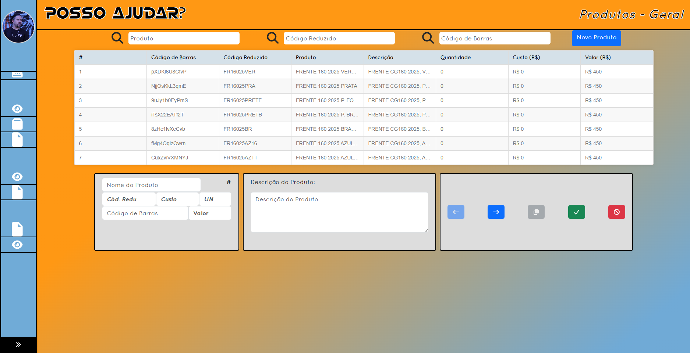
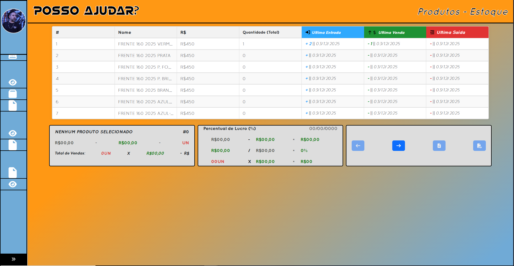
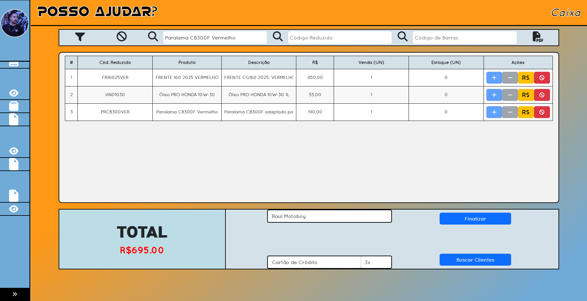

# Posso Ajudar? — Guia do Usuário

Este guia apresenta as principais funções do **Posso Ajudar?** e orienta a configuração inicial do sistema. Ele foi escrito para quem está começando a utilizar a aplicação, sem exigir conhecimento técnico.

> **Importante:** o Posso Ajudar? é utilizado aqui para controle interno. As notas, os PDFs e os cupons emitidos pelo sistema **não têm validade fiscal** e não substituem documentos fiscais oficiais.

## Sumário

1. [Configuração Inicial](#1-configuração-inicial)
   - [1.1. Registro do primeiro usuário](#11-registro-do-primeiro-usuário)
   - [1.2. Cadastro e gerenciamento de produtos](#12-cadastro-e-gerenciamento-de-produtos)
   - [1.3. Cadastro e gerenciamento de serviços](#13-cadastro-e-gerenciamento-de-serviços)
   - [1.4. Cadastro e gerenciamento de clientes](#14-cadastro-e-gerenciamento-de-clientes)
   - [1.5. Funcionamento do Sistema](#15-funcionamento-do-sistema)
2. [Módulos de Relatórios](#2-módulos-de-relatórios)
   - [2.1. Relatórios de produtos](#21-relatórios-de-produtos)
   - [2.2. Relatórios de serviços](#22-relatórios-de-serviços)
3. [Movimentações de estoque](#3-movimentações-de-estoque)
4. [Módulo Caixa](#4-módulo-caixa)
5. [Controle de usuários](#5-controle-de-usuários)
6. [Dados da empresa](#6-dados-da-empresa)

---

## 1. Configuração Inicial

Antes de começar a vender, recomendamos configurar o usuário inicial e cadastrar os produtos e serviços que serão utilizados no dia a dia. O cadastro de clientes é opcional.

### 1.1. Registro do primeiro usuário

O registro inicial serve para preparar o acesso ao sistema.

1. Abra a opção **Registro** na tela inicial.
2. Preencha os dados solicitados e finalize o cadastro.
3. O primeiro usuário recebe o perfil de **Proprietário/Superusuário**, com permissões administrativas para configurar o sistema.
4. Depois que a configuração inicial estiver concluída, crie os demais acessos pela área **Controle de Usuários**, no perfil do usuário.

### 1.2. Cadastro e gerenciamento de produtos

Cadastre os produtos que serão vendidos no caixa e acompanhados no estoque.

**Campos do cadastro**

- **Nome:** identificação do produto.
- **Código reduzido:** opcional. Se ficar em branco, o sistema preenche automaticamente.
- **Código de barras:** opcional. Se ficar em branco, o sistema preenche automaticamente.
- **Custo:** quanto a empresa paga para adquirir o produto. Esse valor é importante para estimar o lucro, comparando o custo com o valor de venda, e para os relatórios de gastos e perdas.
- **Valor:** preço de venda do produto.
- **Quantidade inicial:** quantidade que existe no estoque no momento do cadastro.

**Ações disponíveis**

- **Desativar:** impede que o produto continue sendo utilizado normalmente, sem apagar seu histórico.
- **Copiar:** cria um cadastro a partir dos dados de um produto existente, facilitando o registro de itens semelhantes. Confira os códigos antes de salvar a cópia.
- **Editar:** altera os dados do produto.
- **Adicionar ao estoque:** registra uma entrada de unidades.
- **Retirar do estoque:** registra a saída de unidades.

> **Atenção:** entradas, retiradas, vendas e alterações relacionadas ao estoque devem ser consultadas na aba **Movimentações**. Uma retirada manual é registrada como perda/saída, não como venda.

### 1.3. Cadastro e gerenciamento de serviços

Cadastre os serviços oferecidos pela empresa.

**Campos do cadastro**

- **Nome:** identificação do serviço.
- **Código reduzido:** opcional; o sistema preenche automaticamente se não for informado.
- **Código de barras:** opcional; o sistema preenche automaticamente se não for informado.
- **Valor do serviço:** valor cobrado pelo serviço.
- **Adicionar produtos:** opcional. É possível vincular produtos utilizados ou fornecidos junto com o serviço. Os valores dos produtos adicionados entram na composição do total do serviço.

**Ações disponíveis**

- **Desativar:** deixa de disponibilizar o serviço para uso normal, preservando seu histórico.
- **Copiar:** facilita criar outro serviço com dados semelhantes; revise os códigos e os valores antes de concluir.
- **Editar:** permite alterar as informações e adicionar ou remover produtos associados.

### 1.4. Cadastro e gerenciamento de clientes

O cadastro de clientes é **opcional**. É possível registrar uma venda sem associá-la a um cliente.

O cadastro é feito diretamente na **Frente de Caixa**: ao digitar o nome de um cliente que ainda não existe, o sistema permite cadastrá-lo. Inicialmente, podem ser informados apenas o **nome** e o **CPF**.

Na área **Clientes — Visão Geral**, é possível consultar os registros e utilizar a opção **Editar** para completar ou atualizar os dados, incluindo o endereço completo.

> **Atenção:** para preservar o histórico, clientes, produtos e serviços não devem ser excluídos definitivamente. Quando necessário, devem ser desativados, mantendo os registros anteriores.

### 1.5. Funcionamento do Sistema

As opções de **Funcionamento do Sistema** ficam no perfil do usuário. A configuração é opcional e pode ser ajustada conforme a necessidade da empresa.

- **Chave Pix:** informa a chave usada para gerar o QR Code de pagamento, quando essa opção estiver disponível.
- **Permissões dos usuários:** permite ajustar o nível de acesso. O **nível 3 — Superusuário** pode apagar, editar e modificar configurações de todo o sistema. Usuários com níveis inferiores ficam limitados às permissões concedidas ao seu perfil.
- **Unidade de medida:** permite alterar a nomenclatura da unidade utilizada nos produtos, como a forma de identificação de uma unidade.
- **Exportação e importação do banco de dados:** permite exportar uma cópia dos dados e importar um arquivo de banco de dados.

> **Recomendação:** exporte uma cópia de segurança antes de importar dados. Verifique o arquivo selecionado e certifique-se de que ele é o correto para a empresa.

---

## 2. Módulos de Relatórios

Os relatórios ajudam a acompanhar os gastos, os ganhos e as perdas registradas no sistema. Os relatórios disponíveis contam com opção de **exportação para PDF**.

### 2.1. Relatórios de produtos

Acesse **Produtos → Relatórios** para consultar os resultados dos produtos.

- **Gráfico de barras:** mostra, por produto, quanto foi gasto, quanto foi ganho e quanto foi perdido quando houve saída sem venda.
- **Seleção de produtos:** cada produto exibido no gráfico de barras pode ser selecionado para compor o gráfico de pizza, facilitando a comparação entre os itens escolhidos.
- **Gráfico de resumo geral:** apresenta uma visão conjunta dos produtos, reunindo ganhos, gastos e perdas registrados.
- **Exportação:** use a opção de exportar para salvar o relatório em PDF.

Os resultados dependem das informações de custo, das vendas e das movimentações registradas no sistema.

### 2.2. Relatórios de serviços

Acesse **Serviços → Relatórios** para consultar os resultados dos serviços.

A navegação segue uma lógica semelhante à dos relatórios de produtos: o gráfico de barras permite analisar os serviços, e a seleção de itens permite compará-los no gráfico de pizza. O gráfico final apresenta uma comparação geral dos **ganhos dos serviços**.

Os relatórios podem ser exportados para PDF.

---

## 3. Movimentações de estoque

A área **Movimentações** mantém o histórico das alterações relacionadas aos produtos. Ela ajuda a identificar quando o estoque recebeu unidades, quando houve uma venda, quando ocorreram perdas ou quando um produto foi editado.

Os registros incluem:

- **Entrada:** unidades adicionadas ao estoque.
- **Venda:** unidades movimentadas por uma venda realizada no caixa.
- **Perda/saída:** unidades retiradas sem serem registradas como venda.
- **Edição:** registro relacionado a alterações nos dados do produto.

Também há botões para **adicionar entrada** e **adicionar saída** de produtos.

> **Atenção:** para os relatórios, uma saída manual é contabilizada como perda, não como venda. Para registrar uma venda, utilize o Módulo Caixa.

---

## 4. Módulo Caixa

O **Caixa** é a área utilizada para realizar vendas de produtos. Nele também é possível cadastrar um cliente durante a venda, sem precisar preparar esse cadastro antecipadamente.

**Recursos principais**

- **Busca de produtos:** pesquise por nome, código reduzido ou código de barras.
- **Filtros e colunas:** use o botão de filtro para adicionar ou remover colunas exibidas na listagem de produtos.
- **Limpar filtros:** use a opção correspondente para limpar os filtros de busca aplicados.
- **Histórico de vendas:** o ícone à direita permite consultar as vendas realizadas.
- **Comprovantes:** no histórico, é possível gerar um PDF ou imprimir um cupom para controle interno.
- **Exclusão de vendas:** somente usuários com **nível 3** podem excluir vendas.

> **Atenção:** os PDFs, notas e cupons emitidos pelo sistema são documentos de controle interno e não possuem validade fiscal. A exclusão de uma venda deve ser feita com cuidado, pois afeta os registros do sistema.

---

## 5. Controle de usuários

A opção **Controle de Usuários** fica no perfil do usuário e permite administrar os acessos ao sistema.

Nessa área, um usuário autorizado pode:

- adicionar um novo usuário;
- consultar os usuários cadastrados;
- editar as permissões de cada usuário conforme o nível de acesso necessário.

Conceda permissões administrativas apenas a pessoas que realmente precisam delas. O **nível 3 — Superusuário** possui os poderes administrativos mais amplos, incluindo a exclusão e a alteração de registros e configurações do sistema.

---

## 6. Dados da empresa

Na seção **Empresa**, preencha e mantenha atualizados os dados da empresa. Essas informações são utilizadas na identificação exibida nos documentos e comprovantes de venda gerados pelo sistema.

Revise os dados sempre que houver alguma alteração nas informações da empresa.

> **Importante:** os documentos gerados pelo Posso Ajudar? são destinados ao controle interno. Eles **não são notas fiscais com validade fiscal** e não substituem a emissão de documentos fiscais oficiais.

---

## Boas práticas de uso

- Mantenha os custos e os preços de venda dos produtos atualizados para que os relatórios sejam mais úteis.
- Registre entradas e retiradas corretamente; não utilize uma saída manual para representar uma venda.
- Faça exportações de segurança regularmente, especialmente antes de importar dados.
- Desative, em vez de excluir definitivamente, clientes, produtos e serviços para preservar o histórico.
- Revise as permissões antes de conceder acesso a outro usuário.
- Lembre-se de que notas, PDFs e cupons do sistema são apenas para controle interno e não têm validade fiscal.

---